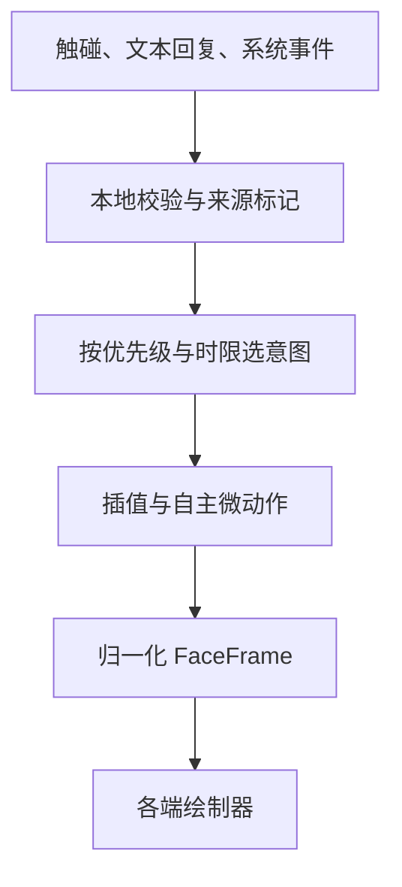

# HappyFace 动画系统设计 v0.2

表情系统是整块矩形屏幕。猫耳、身体等外部部件不进入共享画布。优先覆盖 800×480、400×320、320×240；手机竖屏另行确定构图。展板上的 25 种表情是视觉方向，其中 6 种先作为参数化的基础意图；**不把 25 张图当作逐帧素材播放**。

## 1. 数据流和职责



- 云端模型只产生高层意图；不能控制每一帧，也不能自行声明 `SYSTEM` 优先级。未来接入 DeepSeek 时，由本地适配器解析、校验并标记为 `DIALOGUE`。API 密钥只在服务端。
- `ExpressionEngine` 不依赖网络、屏幕像素或 Compose。触碰、眨眼、呼吸和回退在离线时正常运行。
- 绘制器负责把 `FaceFrame` 变成像素；可以分别为 Compose、网页或设备屏幕实现，但形态参数及时间线共用。

## 2. 意图协议

```json
{
  "mood": "CURIOUS",
  "intensity": 0.9,
  "gazeX": -0.4,
  "gazeY": 0.1,
  "holdMs": 2200
}
```

| 字段 | 含义 | 本地规则 |
| --- | --- | --- |
| `mood` | 语义形态 | 初始白名单：`CALM`、`CURIOUS`、`HAPPY`、`SHY`、`THINKING`、`SLEEPY`；未知字符串由接入层拒绝 |
| `intensity` | 目标形态相对平静态的强度 | 有限数，裁剪到 0–1；0 回到平静形态，1 达到预设形态 |
| `gazeX`, `gazeY` | 视线目标，左/上为负 | 有限数，裁剪到 -1–1 |
| `holdMs` | 意图占用来源通道的时长 | 裁剪到 100–15000 毫秒；省略时 2400 毫秒 |

`NaN` 和无穷值被拒绝；解析失败、未知形态或未校验的模型输出不进入引擎。`IntentSource` 是本地调用参数，不是云端 JSON 字段。

## 3. 意图调度与打断

优先级：`SYSTEM` > `TOUCH` > `DIALOGUE` > 自主待机。每个来源最多保留一个尚未过期的意图，新指令替换同来源旧指令。高优先级意图到来时，低优先级意图的计时**继续**；前者结束后，只恢复仍有效的低优先级意图，否则回到 `CALM`。`clear(source)` 可提前结束系统提示。

触碰立即生成本地 `CURIOUS` 意图，持续 1800 毫秒。云端回复若在触碰期间到达，不会抢走触碰反馈。任何切换都从**当前** `FaceFrame` 插值，打断不会从某张预设图的第一帧重播。过期与背景恢复按真实经过的时间处理，不补播错过的眨眼。

## 4. 形态参数

`FaceFrame` 是每帧不可变快照，坐标、强度均与屏幕尺寸无关：

| 参数组 | 控制内容 | 约束 |
| --- | --- | --- |
| `eyeRing`, `eyeArch`, `eyeCrescent`, `eyeHalf`, `eyeSleep` | 圆眼、弯眼、月牙眼、半垂眼、困倦眼的绘制权重 | 各项在 0–1，权重之和为 1 |
| `mouthW`, `mouthO`, `mouthFlat` | 小弯嘴、惊讶小圆嘴、思考横线 | 各项在 0–1，权重之和为 1 |
| `eyeOpen`, `eyeRoundness`, `smile`, `blush` | 开合、圆润度、微笑、腮红强度 | 绘制层可继续细分曲率和色彩，不增加云端控制权限 |
| `gazeX`, `gazeY`, `breath` | 视线、呼吸位移/缩放的归一化系数 | 容器按画布 `unit = min(width/5, height/3)` 换算像素 |

| 基础形态 | 主要眼形 | 嘴形 | 附加参数 |
| --- | --- | --- | --- |
| 平静 | 空心圆 | 小弯嘴 | 待机注视 |
| 好奇 | 月牙眼 | 小圆嘴 | 注视触碰位置 |
| 开心 | 弯眼 | 小弯嘴 | 椭圆腮红 |
| 害羞 | 弯眼 | 小弯嘴 | 线条腮红，可偏移视线 |
| 思考 | 半垂眼 | 短横线 | 稍向上看 |
| 困倦 | 困倦眼 | 小弯嘴 | 眼睛半开 |

形态混合采用相同的时间参数 `1-exp(-7.5*dt)`；绘制器按权重混合轮廓或透明度，不用瞬间切换资源。今后为展板其他表情扩展预设、装饰层（汗滴、感叹号、眼泪等）和局部曲率参数，无需让大模型输出像素坐标。

## 5. 自主微动作

- 平静注视：每隔约 3–7 秒确定一个小幅随机视线目标，平缓移动；有交互意图时让出视线。
- 眨眼：间隔约 2.2–5.6 秒；闭合约 90 毫秒、睁开约 110 毫秒，使用平滑加减速。随机序列可通过种子重现。
- 呼吸：约 3.7 秒周期，默认归一化幅度 0.012；绘制器只做轻微缩放/位移。
- `setMotionScale(0..1)` 缩小或暂停自主微动作，不关闭主动交互与意图插值。
- `tick(deltaSeconds)` 接受真实经过秒数；无效值按零处理，单次最多推进 60 秒。长时间后台恢复时过期意图立即失效，跳过错过的眨眼。

## 6. 绘制与验收边界

当前仓库的共享 Kotlin 内核实现上述意图时限、优先级、参数混合和微动作。**Compose 绘制器仍是早期原型，尚未完整消费新眼形权重**；演示站点使用独立 JavaScript Canvas 绘制器，也尚未接入共享 Kotlin 核心。这两项接下来要按同一 `FaceFrame` 对齐。

动画验收依次检查：中途打断无数值跳变；触碰与对话优先级正确；指令到期自然回落；不同帧率下同一时间的状态近似；固定种子可重放；后台恢复不补播眨眼；三款屏幕眼睛和嘴不被裁切。视觉验收再对照《伴侣机器人表情系统展板.png》逐一调整线宽、比例、辉光与 25 种形态。
